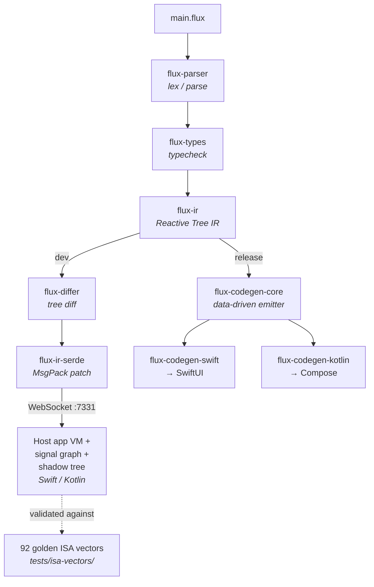

import { Aside, Code, FileTree } from '@astrojs/starlight/components';

Flux est un espace de travail Rust de 16 crates (~63 k lignes) plus des implémentations hôtes natives en Swift et Kotlin. Comprendre le pipeline explique chaque comportement observable — pourquoi les sauvegardes sont rapides, pourquoi l'état survit aux éditions, et pourquoi dev et release restent équivalents.

## Le pipeline

Une source, deux consommateurs. L'étage dev diffe et patche ; l'étage release codegen. Les deux partent du même Reactive Tree IR, ce que vérifie le harnais de parité.

## Les crates

| Crate | Rôle |
| --- | --- |
| `flux-syntax` | Spans, NodeId, hachage FNV-1a des ids de nœud, vocabulaire de valeur/patch |
| `flux-parser` | Lexer écrit à la main + parseur à descente récursive avec récupération d'erreur |
| `flux-types` | Vérificateur de types sur l'arbre de parse |
| `flux-ir` | Reactive Tree IR : arène, IDs de nœud u32 stables, table bytecode ClosureIR, InstanceRegistry |
| `flux-ir-serde` | (Dé)sérialisation de patch binaire — MessagePack, adressage de contenu blake3 |
| `flux-differ` | Differ d'arbre structurel produisant des scripts d'édition minimaux |
| `flux-vm-ref` | VM à registres de référence — l'oracle comportemental pour l'ISA |
| `flux-devserver` | Pipeline de hot-reload, canal de patch WebSocket, serveur d'assets HTTP |
| `flux-codegen-core` | Émetteur partagé data-driven (trait Backend, registre de primitives) |
| `flux-codegen-swift` | Backend SwiftUI avec un pont node-ID |
| `flux-codegen-kotlin` | Backend Jetpack Compose avec un pont node-ID |
| `flux-cli` | Le binaire `flux` |
| `flux-parity` | Harnais de parité VM dev == codegen release |
| `flux-lsp` | Serveur de langage (async-lsp) |
| `flux-devtools-ui` | Application de bureau DevTools gpui sur le même protocole filaire |
| `flux-perf-harness` | Mesure de performance de rendu contre les budgets de latence |

## Identité de nœud stable

Les Node IDs sont des **hachages FNV-1a-32 dérivés du contenu — jamais séquentiels**. Deux familles de tags gardent les IDs d'expression et de déclaration disjoints, et les backends de codegen traversent exactement les mêmes tags de famille dans leurs ponts node-ID.

C'est l'astuce porteuse derrière le hot-reload : parce que les IDs sont stables à travers les éditions où la structure ne change pas, un hot swap préserve l'état des composants. Le champ de texte à moitié tapé de l'app todo survit à chaque sauvegarde parce que l'hôte fait correspondre le nouveau arbre à l'ancien par ID.

## Indexation des props

Les indices de props sont des FNV-1a-32 du **nom** de la prop, masqués à `u16`, dérivés identiquement par les kits hôtes (`PropsIndex.propIndexForName` sur Android). Les indices ne sont jamais codés en dur — un indice codé en dur désynchronise du serveur et rend une UI silencieusement vide.

## L'arbre d'ombre et la réconciliation par clé

L'arbre d'ombre n'est pas un arbre de vues natives brutes. Chaque `ShadowNode` tient ses props matérialisées dans un store observable par la plateforme : sur Android, les props vivent dans un `MutableState` Compose (injecté via `propsStateFactory`, parce qu'un simple `var` est invisible pour le suivi d'instantané) ; sur iOS l'arbre est observé nativement.

La **réconciliation par clé** fait correspondre les enfants par `nodeId` — un nœud existant est réordonné, jamais recréé — préservant la position de défilement, le contenu des champs de texte et l'état d'écran à travers les diffs et les push/pop de routeur.

## Trois contrats normatifs

<Aside type="caution">Trois contrats sont normatifs et versionnés dans
`docs/spec/mlp-appendices.md` : le **protocole filaire** (Annexe D), l'**ISA VM** (Annexe E) et les **contrats d'adaptateur** (Annexe F). Les changements transversaux de l'un d'eux exigent une ADR et un bump de version de protocole.</Aside>

## Étapes suivantes

- [Réactivité](/explanation/reactivity/) — l'invariant qui fait qu'un tap coûte une mise à jour.
- [Dev vs release](/explanation/dev-vs-release/) — pourquoi deux étages d'exécution.
